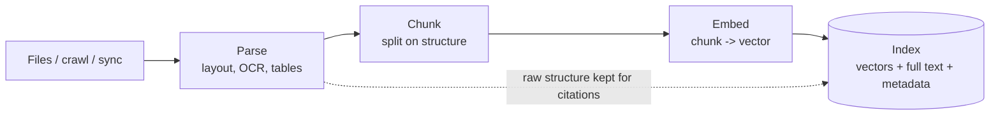
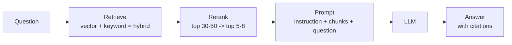
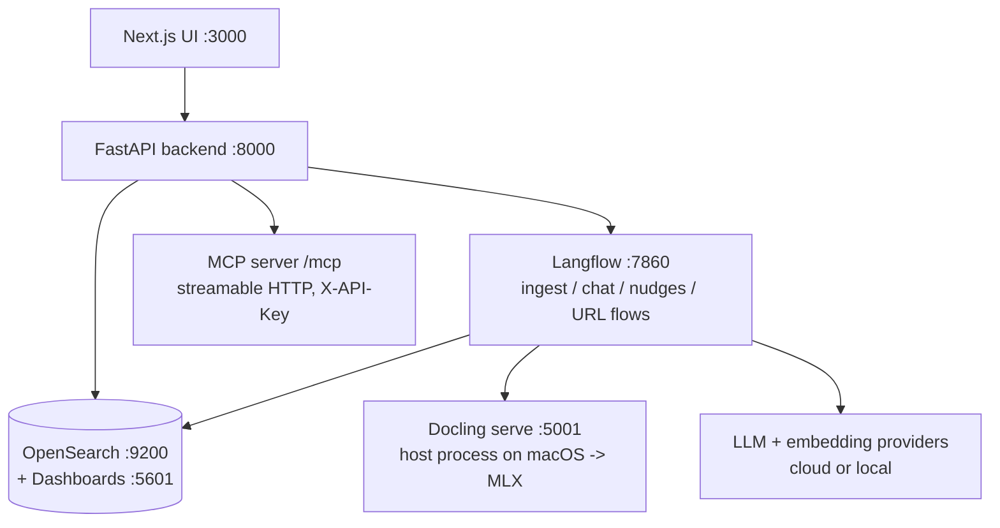
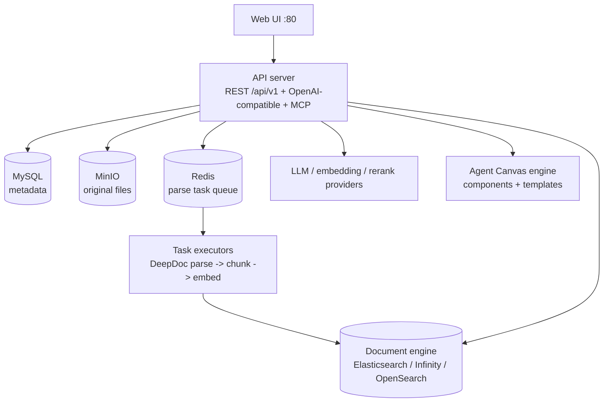

# OpenRAG vs RAGFlow — The Comprehensive Guide

*Everything about both systems, how they work internally, how they differ,
and how to choose. Companion to the two runnable POCs in this repo
(`../openrag-poc/`, `../ragflow-poc/`), the concept primer
([`concepts.md`](concepts.md)) and the measurement method
([`evaluation-guide.md`](evaluation-guide.md)).*

---

## Table of contents

1. Why RAG, and why these two
2. The RAG pipeline, stage by stage (shared foundation)
3. OpenRAG in depth
4. RAGFlow in depth
5. Head-to-head comparison (14 dimensions)
6. Performance: what actually determines ingestion and query time
7. Quality: what actually determines answer correctness
8. Integration patterns — using either system as an agent skill
9. Security, access control and data governance
10. Operations: deployment, scaling, upgrades, observability
11. Cost model
12. Risks and failure modes
13. Decision framework — which one, for what
14. How to run a defensible POC (summary of this repo's method)
15. Glossary

---

## 1. Why RAG, and why these two

Large language models are frozen at training time, know nothing about your
internal documents, and will confidently invent an answer when they don't
know. RAG fixes all three by fetching evidence from *your* corpus at query
time and grounding the answer in it, with citations a human can check.

Both candidates are **open-source (Apache-2.0), self-hostable, model-agnostic
RAG platforms** — not libraries. They compete with managed services
(Vertex AI Search, Azure AI Search, Bedrock Knowledge Bases, Glean) on data
control and customisability, and with DIY stacks (LangChain/LlamaIndex +
a vector DB) on time-to-working-system.

They differ in *philosophy*, which is the real subject of this evaluation:

- **OpenRAG assembles.** It takes three mature, best-of-breed open-source
  components — **Docling** for parsing, **OpenSearch** for search,
  **Langflow** for orchestration — and pre-wires them into one installable
  product. Its bet: *the components are excellent; the value is integration
  and an editable pipeline.*
- **RAGFlow builds.** InfiniFlow wrote its own deep document-understanding
  engine (**DeepDoc**), its own template chunking, its own retrieval
  workbench and (optionally) its own search engine (**Infinity**). Its bet:
  *parsing and retrieval quality are the product; own them end to end.*

## 2. The RAG pipeline, stage by stage

### 2.1 Ingestion-time flow

### 2.2 Query-time flow

**Parsing** is the most under-rated stage. A PDF is a drawing format, not a
text format: a naive extractor loses columns, merges table cells, drops
headers/footers into the middle of sentences and produces text no retriever
can rank well. Both systems invest heavily here (Docling vs DeepDoc) —
in many real corpora, *parsing quality explains more answer failures than
model choice.*

**Chunking** converts a parsed document into retrieval units. Key parameters:
size (tokens), overlap, and boundary policy (fixed window vs structure-aware:
headings, Q&A pairs, table rows, pages). A chunk must be *self-explanatory* —
a table row without its header row is a fact without a subject.

**Embedding** maps text to a high-dimensional vector (e.g. 768–3072 dims)
such that semantic similarity ≈ cosine similarity. Consequences that matter
operationally:

- One index should hold vectors from **one** embedding model (mixing models
  mixes coordinate systems). RAGFlow enforces this per dataset; OpenRAG
  stores multiple models side-by-side in one OpenSearch index under separate
  fields, which eases migration but demands discipline.
- Changing the embedding model means **re-embedding the entire corpus**.
  Budget for it; it is an ingestion run, not a config flip.

**Retrieval — three flavours:**

| Flavour | Mechanism | Wins on | Fails on |
|---|---|---|---|
| Dense / vector | nearest vectors to the query vector | paraphrases, synonyms, conceptual questions | exact codes, names, numbers, negations |
| Sparse / BM25 | classic term-frequency scoring | exact terms: permit numbers, part numbers, legal phrases | wording different from the document |
| **Hybrid** | weighted sum / rank fusion of both | real corpora (both failure modes present) | tuning burden: the weight is corpus-dependent |

Both systems do hybrid by default. RAGFlow exposes the fusion explicitly
(keyword weight default ~0.7, similarity threshold ~0.2, fused reranking);
OpenRAG's weighting lives in its Langflow retrieval flow.

**Reranking** runs a cross-encoder (query+chunk scored together) over the
retrieved candidates. It is the cheapest large quality win in most RAG
systems and the first knob to try when the right chunk is "retrieved but
not used" — check whether it was in the top-K after rerank, not just in the
candidate pool.

**Generation and grounding.** The prompt instructs the model to answer from
the supplied chunks and cite them. Grounding is a *system property*, not a
model property: weak retrieval + a strong model still hallucinates, it just
hallucinates fluently. Measure it (gold questions whose answer is absent —
the system must refuse) rather than trusting it.

**Advanced patterns:**

- **Agentic RAG** — a loop: plan → retrieve → self-check evidence → retrieve
  again / call tools → answer. Helps multi-hop and multi-document questions;
  costs latency and tokens on simple ones.
- **GraphRAG** — index-time entity/relation extraction forms a knowledge
  graph; query-time traversal answers relationship questions ("which X are
  connected to Y through Z") that chunk similarity cannot.
- **RAPTOR** — recursively summarised chunk trees; summary-level questions
  retrieve summaries instead of hoping one chunk contains the whole theme.
- **HyDE / query rewriting / multi-query** — transform the question before
  retrieval (hypothetical answer, keywords, sub-questions). Both platforms
  can do this inside their flows; it is a flow/canvas edit, not a rebuild.

## 3. OpenRAG in depth

### 3.1 Identity card

| | |
|---|---|
| Project | `langflow-ai/openrag` — site: openr.ag, docs: docs.openr.ag |
| Backers | Langflow team with IBM's open-source AI ecosystem (Docling is IBM Research) |
| Licence | Apache-2.0 |
| Stack | Python (FastAPI/Starlette backend), Next.js frontend, Langflow, OpenSearch, Docling |
| Maturity | Young (project started 2025, ~4–5k GitHub stars at evaluation time), fast release cadence |
| One-liner | “From documents to intelligent RAG in minutes” — a pre-wired platform, not an engine |

### 3.2 Architecture

Key architectural choices:

1. **The pipeline is data, not code.** Ingestion, chat and nudge behaviour are
   Langflow **flows** (JSON graphs). To change chunking, retrieval, reranking
   or prompts you open the visual editor at :7860 — debuggable by
   non-specialists, versionable as files, and risky in exactly the same way
   (an edited flow *is* a production change; treat it like code).
2. **Multi-model index.** OpenSearch document fields are named
   `chunk_embedding_<normalised-model-name>`, so several embedding models can
   coexist in one index — migration and A/B of embedding models without a
   second index, at the cost of index size.
3. **Docling on the host (macOS case).** Docling serve runs natively at :5001
   rather than in the Linux container specifically so it can use Apple
   Silicon acceleration — a thoughtful platform-specific detail, and why
   OpenRAG is the only one of the two that runs natively on a Mac.
4. **Two access modes, chosen at setup.** *Basic* (no auth — all users see
   all documents) vs *OAuth* (document ownership, per-user/group filtering
   enforced in OpenSearch via token claims). Retrofitting OAuth later is a
   re-setup, so enterprise evaluations must start in OAuth mode.
5. **MCP is a first-class citizen.** The built-in MCP server (mounted at
   `/mcp`, API-key auth) exposes RAG chat, semantic search, ingestion and
   settings tools — OpenRAG is designed to be *called by other AI systems*
   (IDEs, agents), not only to be chatted with.

### 3.3 Data flow details

- **Ingest:** UI or `POST /upload` → Langflow ingestion flow → Docling parse →
  chunk → embed (configured provider) → OpenSearch index. Async with task
  tracking, so large uploads don't block the UI.
- **Query:** UI or `POST /chat` → Langflow chat/agent flow → hybrid retrieval
  (kNN + BM25 in OpenSearch) → optional rerank/agentic steps → LLM → answer
  with source citations. `POST /search` gives retrieval without generation.
- **Knowledge filters:** saved scopes (by source/type) that constrain both
  search and chat — the platform's partitioning concept (vs RAGFlow datasets).
- **Cloud connectors:** in OAuth mode, ingestion can pull from cloud storage
  (Google Drive / OneDrive / SharePoint class sources).

### 3.4 Strengths

- Fastest path from zero to a working, inspectable RAG on a laptop.
- Components are individually excellent and replaceable (Docling and
  OpenSearch have lives of their own; no exotic storage bet).
- Visual flow editing makes the "why did it answer that?" question answerable.
- Native macOS story; Kubernetes/Helm and Docker deployment both documented.
- MCP + Python/TypeScript SDKs make it a clean *retrieval skill* for agents.

### 3.5 Weaknesses / watch items

- Young project: smaller community, fewer production war stories, APIs still
  moving between versions (pin tags; expect config-level adjustments).
- Fewer purpose-built chunking strategies than RAGFlow — chunking quality for
  exotic document types depends on what you build in the flow.
- No GraphRAG/RAPTOR-class index-time enrichment built in.
- Enterprise depth (audit, fine-grained governance, connectors breadth) is
  thinner than the marketing of larger platforms — evaluate, don't assume.

## 4. RAGFlow in depth

### 4.1 Identity card

| | |
|---|---|
| Project | `infiniflow/ragflow` — site: ragflow.io, cloud: cloud.ragflow.io |
| Backer | InfiniFlow |
| Licence | Apache-2.0 |
| Stack | Historically Python services; the 1.0 line moves the server to Go. React UI. MySQL (metadata), MinIO (files), Redis (task queue), Elasticsearch **or** Infinity **or** OpenSearch (document engine) |
| Maturity | Mature and very popular (~90k+ GitHub stars), large issue/PR throughput |
| One-liner | A RAG *engine* — “quality in, quality out” — built on deep document understanding |

### 4.2 Architecture

Key architectural choices:

1. **Upload ≠ parse.** Ingestion is explicitly two-phase: files land in a
   dataset, parsing is triggered (UI **Run**, or `POST /api/v1/datasets/{id}/chunks`)
   and executed asynchronously by task executors. This makes ingestion time
   honestly measurable (upload time vs parse-to-searchable time) and lets you
   re-parse with different settings without re-uploading.
2. **DeepDoc.** Layout analysis (titles, body, tables, figures, headers,
   footers, ~10+ element types), OCR, and **Table Structure Recognition**
   (rows, columns, merged cells, header association). The output preserves
   document structure into chunking — the single biggest determinant of
   retrieval quality on manuals, financials, legal and permit-style documents.
3. **Template chunking + human-in-the-loop.** Chunking strategy is chosen per
   dataset from document-type templates (General, Q&A, Manual, Table, Paper,
   Book, Laws, Presentation, Resume, Picture, One, Tag…). Chunks are rendered
   *on the page image*; a human can edit, split or delete bad chunks.
   No other open-source system makes chunk inspection this tangible.
4. **Dataset is the unit of everything.** One dataset = one embedding model,
   one chunking configuration, one index partition. Chat assistants bind to
   one or more datasets. Permissions, testing and lifecycle all hang off it.
5. **Retrieval workbench.** A dedicated *Retrieval Testing* screen exposes
   similarity threshold, keyword/vector weight, top-K, reranker and
   cross-language options against the live index — tune retrieval with
   evidence, not vibes, before any chat exists.
6. **Beyond chat: Agent Canvas + compilation.** Visual agent workflows
   (retrieval, generation, categorisation, branching, iteration, sandboxed
   code execution, HTTP, MCP tools, sub-agents) with templates; agentic RAG
   with Low/Medium/High/Ultra “thinking” modes; **GraphRAG** and **RAPTOR**
   as dataset-level enrichment options; recent **Knowledge Compilation** into
   wikis/graphs/trees/timelines/skills.
7. **Pluggable document engine.** Elasticsearch by default; **Infinity**
   (InfiniFlow's own engine, purpose-built for hybrid vector+full-text) as an
   alternative that also removes the `vm.max_map_count` operational wart;
   OpenSearch also supported in some builds.

### 4.3 Data flow details

- **Ingest:** upload (UI, API, S3/MinIO sync, web crawl/sitemap, and newer
  connectors such as Confluence/Notion/Drive) → DeepDoc parse → template
  chunk (optionally GraphRAG/RAPTOR enrichment — *expensive*, see §6) →
  embed → document engine. Per-file progress, logs and chunk counts are
  visible; failures are per-file, not per-batch.
- **Query (chat):** assistant config (datasets, prompt, models) → hybrid
  retrieval + fused rerank → prompt assembly → LLM → answer with traceable
  citations positioned in the source.
- **Query (retrieval API):** `POST /api/v1/retrieval` returns ranked chunks
  with scores — the cleanest integration surface for external agents.
- **Query (agent):** Canvas flows chain retrieval with tools and logic; an
  agent can also be exposed over the OpenAI-compatible endpoint.

### 4.4 Strengths

- Best-in-class open-source parsing of complex/scanned/table-heavy PDFs.
- Chunking you can *see and fix*; retrieval you can *tune with a workbench*.
- Dataset/chat/agent separation is a clean mental model at team scale.
- Huge community, frequent releases, cloud offering for zero-install trials.
- REST + Python SDK + MCP + OpenAI-compatible API — integration-complete.

### 4.5 Weaknesses / watch items

- Heavy: documented floor **4 CPU / 16 GB RAM / 50 GB disk**; multi-container
  stack (MySQL, MinIO, Redis, search engine, app) to operate and back up.
- **macOS is not a supported host for the 1.0 line** — Linux (x86-64 or ARM64)
  only; on a Mac you run a VM. Prebuilt images are x86-centric; ARM is a
  build-it-yourself path upstream of the VM approach in this repo.
- GraphRAG/RAPTOR parsing can be dramatically slower and costlier (LLM calls
  per chunk) — enable selectively, never by default in a POC.
- The Agent Canvas overlaps any external agent/router framework you already
  run; adopting RAGFlow *for its agents* while also running your own router
  creates two decision-makers (see §8).
- Fast-moving codebase with breaking changes across minors; the recent Go
  server transition is exactly the kind of change that invalidates old blog
  tutorials — trust the tag's own docs.
- Default stack passwords and published internal ports need hardening before
  anything beyond a laptop (see §9).

## 5. Head-to-head comparison

| # | Dimension | OpenRAG | RAGFlow |
|---|---|---|---|
| 1 | Core idea | Assemble best-of-breed (Docling + OpenSearch + Langflow) | Build deep (DeepDoc + templates + own engine option) |
| 2 | Parser | Docling — layout-aware, broad formats, strong tables/figures | DeepDoc — layout + OCR + table structure recognition, strongest on scans/complex PDFs |
| 3 | Chunking | Flow-configured splitting; fewer presets | Per-type templates; **visual chunk editor** with human correction |
| 4 | Index / search | OpenSearch only | Elasticsearch (default), Infinity, or OpenSearch |
| 5 | Retrieval | Hybrid kNN + BM25, flow-tunable, rerank/agentic steps in flow | Multi-recall hybrid + fused rerank, dedicated tuning UI, explicit weights/thresholds |
| 6 | Advanced RAG | Agentic flows, nudges | GraphRAG, RAPTOR, agentic thinking modes, Knowledge Compilation |
| 7 | Orchestration | Langflow flows (the whole product is flows) | Built-in pipeline + separate Agent Canvas |
| 8 | Admin / UX | Next.js UI: Knowledge, Chat, Settings, flows via Langflow | Full console: Datasets, Files, Retrieval Test, Chat, Agent, model providers |
| 9 | Integration | REST, Python + TS SDKs, **built-in MCP at `/mcp`** | REST `/api/v1`, Python SDK, MCP server, **OpenAI-compatible API** |
| 10 | Access control | Basic (none) vs OAuth (per-user/group doc ACLs) — choose at install | Tenants/users, API tokens, dataset-level organisation; source-system ACL inheritance is limited in both |
| 11 | Resource floor | ~8 GB container RAM, 50 GB disk; runs on a Mac natively | 4 CPU / 16 GB RAM / 50 GB disk; Linux host (VM on a Mac) |
| 12 | Maturity / community | Young (2025), ~4–5k stars, IBM/Langflow orbit | Mature, ~90k+ stars, very active, cloud version exists |
| 13 | Ops burden | Moderate: 5–6 containers, one search engine | Higher: 8+ services incl. MySQL/MinIO/Redis + engine tuning (`vm.max_map_count`) |
| 14 | Best at | Getting a customisable, agent-callable RAG up fast, with components you already trust | Document-heavy corpora where parsing/chunking quality decides success |

**Reading the table honestly:** on a corpus of clean Markdown/HTML both will
look identical, and the POC will “prove” nothing. The differences appear on
scanned pages, merged-cell tables, multi-column layouts, exact-code lookups
and thousand-document scale — which is why this repo's method (§14) insists
on adversarial sample documents.

## 6. Performance — what actually moves the numbers

**Ingestion time** is dominated by, in order: (1) parsing (OCR/layout is
CPU-heavy; DeepDoc and Docling both run CPU inference in these builds —
scanned pages are 10–100× slower than born-digital text), (2) embedding
throughput (provider rate limits if cloud; batch size if local), (3) index
write load. Enrichment (GraphRAG/RAPTOR) dwarfs all of it because it calls an
LLM per chunk/cluster — measure it as a separate configuration, never mixed
into the baseline.

**Query time** decomposes as: embedding the query (small) + retrieval
(10s of ms at POC scale) + rerank (100s of ms with a local cross-encoder)
+ LLM generation (usually 70–90% of wall time). *Therefore:* if both POCs
share the same LLM, total query latency will look similar and that is
expected — the discriminating metrics are **retrieval-only latency** and
**answer correctness**, both of which this repo's harness captures.

**Scale behaviour (qualitative, verify before production claims):**
OpenSearch and Elasticsearch are both proven to large corpora; Infinity
claims better hybrid-search efficiency but has a smaller operational track
record. Neither platform's bottleneck at enterprise scale is search — it is
parsing throughput (horizontally scalable task executors in RAGFlow; flow/
service scaling in OpenRAG) and embedding cost.

## 7. Quality — what actually moves correctness

Ranked by typical impact on a document corpus:

1. **Parsing fidelity** (tables, scans, reading order) — §2.
2. **Chunking fit to document type** (RAGFlow templates + visual fix-ups;
   OpenRAG flow tuning).
3. **Hybrid retrieval + reranking correctly tuned** (threshold too high =
   silence; too low = noise; test on gold queries, not on impressions).
4. **Embedding model quality for your language/domain.**
5. **Prompt discipline** (answer-from-context, say-so when absent).
6. **Chat model** — last, not first. Swapping the LLM rarely rescues a
   retrieval failure, and POCs that “fix” quality by upgrading the LLM are
   measuring the wrong layer.

## 8. Integration patterns — as an agent skill

If RAG sits behind an agent framework/router (e.g. a skill-based agent where
a router decides *which skill* runs, instead of sub-agents owning flows),
integrate like this:

| Pattern | OpenRAG | RAGFlow | Verdict |
|---|---|---|---|
| **MCP tool** | Built-in `/mcp`, API-key auth — configure and call | MCP server mode available | Cleanest agent-native path for both |
| **Retrieval API as a skill** | `POST /search` | `POST /api/v1/retrieval` (ranked chunks + scores) | Best control: your agent owns prompting/generation |
| **Chat API as a skill** | `POST /chat` / SDKs | Chat completions / OpenAI-compatible endpoint | Fastest to demo; the platform owns the prompt — less control, harder to make answers consistent with your other skills |
| **Embed its UI** | Chat UI exists | Chat UI + shareable assistants | Fine for humans, irrelevant for agents |

Architectural warning that applies to RAGFlow specifically: its **Agent
Canvas is itself an orchestrator**. If your router already classifies intent
and selects skills, let RAGFlow be a *retrieval skill* (patterns 1–2) and
keep decisions in your router. Two orchestrators means two places where
routing, retries and state live — the classic backward-compatibility trap in
agent rewrites. OpenRAG's Langflow flows create the same temptation at
smaller scale; the discipline is identical: flows *inside* the RAG skill are
fine, flows that route *between* skills belong to the router.

## 9. Security, access control, governance

- **Self-hosting ≠ automatically safe.** Both stacks ship developer-grade
  defaults: RAGFlow's compose publishes search/database/object-store ports
  with widely-known default passwords; OpenRAG's Basic mode has *no* user
  separation. For any shared deployment: change every default password,
  bind internal ports to localhost / private network, disable open
  registration (`REGISTER_ENABLED=0` in RAGFlow) after creating accounts,
  and put the UI behind your SSO/reverse proxy.
- **Document-level ACLs** are the hard enterprise problem: the answer must
  only cite documents the *asker* may see. OpenRAG's OAuth mode enforces
  owner/group filtering in OpenSearch. RAGFlow organises by user/tenant and
  dataset, but *inheriting* ACLs from a source system (Drive, Confluence)
  is limited in both — if your POC needs per-document permissions from a
  source system, test that flow explicitly; it is where demos quietly fail.
- **Prompt injection via documents** is real in both: a poisoned document can
  instruct the LLM. Mitigations are architectural (treat retrieved text as
  data, constrain tools, human-approve side-effecting agent actions) — no
  RAG platform solves this for you.
- **Data residency** is the strongest argument for either over managed
  services: corpus, vectors and logs stay on your infrastructure; only the
  LLM/embedding calls leave (and those can be local models too).

## 10. Operations

| Topic | OpenRAG | RAGFlow |
|---|---|---|
| Install | `docker compose up` (or the `uv run openrag` TUI/package) | `docker compose up -d` in `docker/` on a Linux host; sysctl prerequisite for Elasticsearch |
| Upgrade | Pull new tag, compose up; re-check flow/API changes | Pull new tag; watch for DB migrations in the app image entrypoint; re-check `docker/.env` |
| Backup | OpenSearch index/snapshots + `.env` + custom flows | MySQL + MinIO + document-engine data + `docker/.env` (all four, consistently) |
| Scaling | Scale backend/Langflow services; OpenSearch cluster for the index | Scale task executors for parsing; engine cluster for search; app replicas |
| Observability | Container logs; OpenSearch Dashboards; Langflow run traces for flows | Container logs (esp. the app/task-executor), per-file parse logs in UI, dataset statistics |
| Kubernetes | Helm charts upstream | Compose-centric; K8s is a DIY/partner path — budget effort |

## 11. Cost model

Software: $0 (Apache-2.0, both). Real costs, in descending order for most
deployments: **(1) LLM + embedding API spend** (embedding is per-ingested-token —
re-parsing a corpus with a new template/model re-buys it; GraphRAG multiplies
it), **(2) infrastructure** (a 16 GB-class host/VM minimum for RAGFlow;
smaller for OpenRAG; parsing is CPU-hungry, GPUs help Docling/DeepDoc-class
workloads where supported), **(3) people time** — tuning, chunk fixing, and
evaluation-set maintenance. RAGFlow's cloud version and OpenRAG's ecosystem
services exist if you'd rather buy (1)–(2) as a subscription.

## 12. Risks and failure modes

| Risk | Applies to | Mitigation |
|---|---|---|
| POC on clean docs “proves” the wrong winner | both | adversarial corpus: scans, merged tables, exact codes, absent-answer questions (§14) |
| Version churn breaks your integration | both, OpenRAG more (younger APIs) | pin tags; config-driven endpoint maps (as in `common/bench/`); contract-test the 3–4 endpoints you use |
| Second orchestrator creeps in (Canvas/Langflow routing between skills) | both | §8 discipline: platform orchestrates *inside* retrieval only |
| Ingestion cost explosion from enrichment | RAGFlow (GraphRAG/RAPTOR) | enable per-dataset, measure tokens/time, default off |
| Silent ACL leakage in a shared instance | both | §9 checklist before any non-laptop deployment; test with two users |
| Search-engine operations (heap, `vm.max_map_count`, disk watermarks) surprise you in prod | both (ES/OpenSearch) | load-test ingestion; alert on disk; consider Infinity (RAGFlow) knowingly, with its smaller track record |
| Project/community risk | OpenRAG (young) more than RAGFlow | components are standard (Docling/OpenSearch outlive the wrapper); export path: chunks+vectors are rebuildable from source docs — keep originals sacred in both |

## 13. Decision framework

Choose **OpenRAG** if most of these are true:

- You need a working, customisable RAG *this week*, on a laptop/Mac or a
  small server, without operating a large stack.
- Your team already likes (or wants) Langflow/OpenSearch/Docling, or wants
  every pipeline step visually inspectable/editable.
- The primary consumer is an **agent or IDE via MCP**, or developers via SDKs.
- Documents are mostly born-digital; parsing is good-enough with Docling.

Choose **RAGFlow** if most of these are true:

- Your corpus is **document-hostile**: scans, complex tables, multi-column
  PDFs, manuals/permits/financials — parsing quality is the whole game.
- You will invest in tuning: chunk templates, retrieval weights, rerankers —
  and want the workbench built for exactly that.
- You need dataset/chat/agent separation for multiple teams/use-cases, and
  possibly GraphRAG/RAPTOR-class enrichment later.
- You can give it a proper Linux host (or VM) and operate its stack.

Choose **neither (yet)** if: your corpus is tiny and clean (an LLM with the
documents in context, or a simple pgvector setup, is less machinery), or your
real requirement is enterprise search across live SaaS with inherited ACLs
(evaluate connector-first platforms instead), or nobody will own evaluation —
an unmeasured RAG decays silently.

**Tie-breaker experiment (one afternoon):** take the 5 nastiest real
documents you own. Run both POCs in this repo on them with the 12-question
method (§14). The system whose *chunks* you don't have to apologise for wins —
chunk quality is upstream of everything else.

## 14. How to run a defensible POC (this repo's method, summarised)

1. Same corpus, same chat model, same embedding model, same questions,
   both systems, one at a time. (`README.md` quick start.)
2. Measure **upload time** and **time-to-searchable** per file
   (`common/bench/bench.py`), plus a stopwatch cross-check in each UI.
3. Measure **query latency**: 1 cold + 3 warm runs per gold question,
   streaming off; report median/p95; also time retrieval-only calls.
4. Score quality: keyword hit-rate (automatic), citation spot-check,
   table/scan exactness, and two **absent-answer** questions where refusing
   is the only correct behaviour.
5. Test integration as you'll actually use it: MCP + one REST pattern (§8).
6. Record everything in `docs/results-template.md` → `results/RESULTS.md`,
   including what broke. That file is the deliverable a decision can be
   made from.

## 15. Glossary

- **BM25** — classic keyword ranking (term frequency, rarity, length). The
  “sparse” half of hybrid search.
- **Chunk** — a retrievable slice of a parsed document, with metadata.
- **Cross-encoder / reranker** — model scoring (query, chunk) pairs jointly;
  slower and more accurate than vector distance.
- **Dataset (RAGFlow)** — a knowledge base: files + one embedding model +
  one chunking config. **Knowledge (OpenRAG)** — the document collection,
  scopable with knowledge filters.
- **DeepDoc** — RAGFlow's parser (layout + OCR + table structure).
- **Docling** — IBM's open-source document parser, used by OpenRAG.
- **Embedding** — vector representation of text from an embedding model.
- **GraphRAG / RAPTOR** — index-time enrichments: entity graph / summary tree.
- **Grounded answer** — an answer whose claims cite retrieved chunks.
- **Hybrid search** — fused vector + keyword retrieval.
- **Infinity** — InfiniFlow's document/search engine, a RAGFlow option.
- **Langflow** — visual flow builder/orchestrator; OpenRAG's engine room.
- **MCP** — Model Context Protocol; how agents call tools (here: RAG) in a
  standard way.
- **Nudges (OpenRAG)** — generated follow-up question suggestions.
- **OpenSearch** — Apache-2.0 search engine (Elasticsearch fork); OpenRAG's
  index, an option elsewhere.
- **Template chunking (RAGFlow)** — per-document-type chunking presets.
- **Time to searchable** — from upload start until a probe query retrieves
  the document. The ingestion metric that matters.
