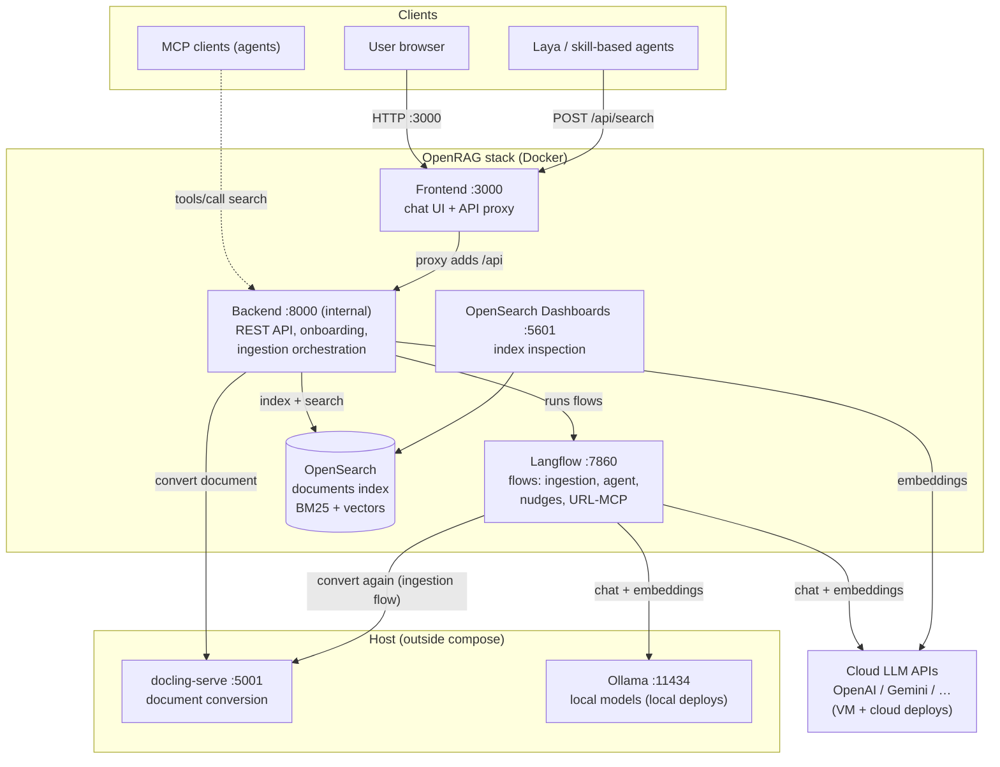
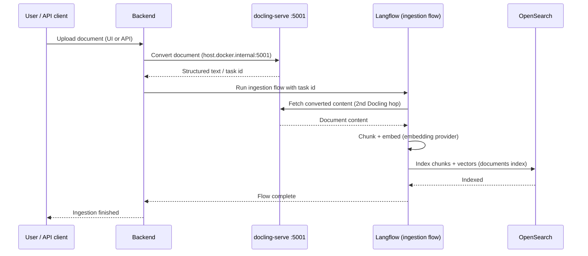
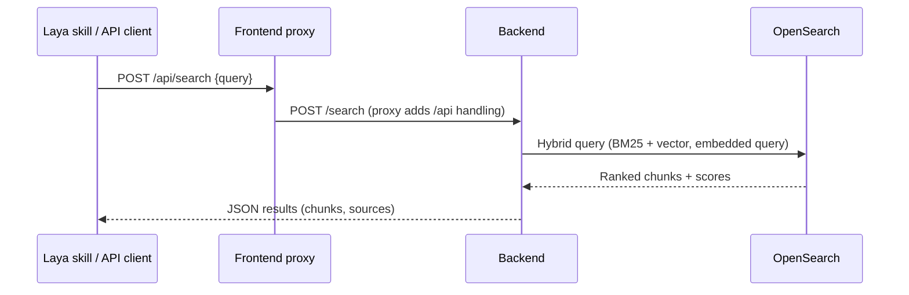
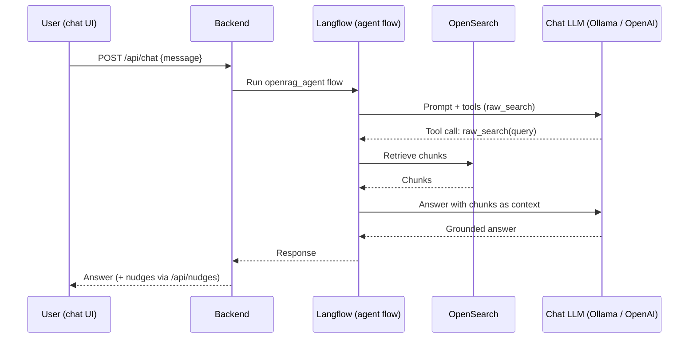
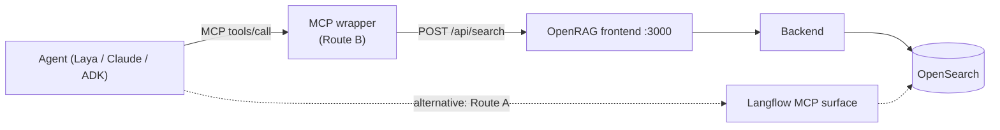

# OpenRAG — Design and Deployment

**Scope:** OpenRAG only — its architecture, how it works, and how to deploy it in
three topologies (local Mac, single GCP VM, Kubernetes). Everything in this
document comes from hands-on deployments run in November 2026: a local Mac
install, a Mac mini install, and a GCP VM deployment, all on OpenRAG **v0.3.0**.

**Upstream:** `langflow-ai/openrag` (https://github.com/langflow-ai/openrag)

**Companion artifacts:**

- VM runbook + patch: `rag-pocs` repo → `openrag-poc/vm-deployment/`
  (`README.md`, `docker-compose.override.yml`, `agent-include-fix.patch`)
- Local one-command setup: `openrag-gemma-local` repo (`setup.sh`)
- Kubernetes charts: `khoj-ai` repo → `charts/openrag-*` (designed, not yet installed)

---

## 1. What OpenRAG is, and its role

OpenRAG is an open-source retrieval-augmented generation (RAG) stack built on
**Langflow**. You upload documents; it converts them (Docling), chunks and
embeds them into **OpenSearch**, and answers questions over them through a
Langflow agent flow that can call a `raw_search` retrieval tool. It ships a
chat UI, a REST API, and provider pluggability for the chat LLM and the
embedding model (OpenAI, Ollama, and others).

**Its role in our architecture:** OpenRAG is evaluated as a **retrieval skill
behind Laya** (the skill-based agent platform), *not* as a replacement router.
The integration surface that matters most is therefore the search API
(`POST /api/search`), which returns grounded chunks directly and bypasses the
chat-agent layer entirely. The chat UI is a useful test bench and demo
surface, but the production-shaped contract is: *Laya decides → the OpenRAG
skill retrieves → the answer layer generates.*

Two upstream facts shape every deployment decision:

1. **Retrieval is hard-wired to OpenSearch.** There is no pluggable vector
   store in v0.3.0; Vertex AI Search is not a supported index (integrating it
   would be custom work).
2. **There is no self-serve user signup.** Auth is OIDC-style
   (`/auth/init`, `/auth/callback`, `/auth/jwks`, `/users/me/permissions`)
   plus an IBM login. Hosting OpenRAG for end users requires an external IdP
   in front of it — which is why the hosted product surface (Khoj.ai) was
   built separately, with OpenRAG kept as the back-office/POC stack.

---

## 2. System diagram



### Components

| Component | Port | Role | Notes |
|---|---|---|---|
| Frontend | 3000 | Chat UI; proxies API calls to the backend | The proxy adds the `/api` prefix — backend routes themselves do not start with `/api` |
| Backend | 8000 (not host-published) | REST API: onboarding, upload/ingestion, search (`/api/search`), chat (`/api/chat`, `/api/nudges`), provider health | Python/FastAPI-style service; ~0.4 GB RAM steady state |
| Langflow | 7860 | Executes the four flows (below); holds flow definitions in its own DB (`langflow.db`) | ~1.1 GB RAM; stored flows are *locked* (HTTP 423) — updates propagate by delete + re-import |
| OpenSearch | 9200 (internal) | The one and only index: chunks + embeddings, hybrid search | ~1.7 GB RAM; upstream expects a multi-node cluster (see §5.2 fix 1) |
| OpenSearch Dashboards | 5601 | Inspecting the index | ~0.2 GB RAM |
| docling-serve | 5001 | Converts PDF/DOCX/HTML/etc. to structured text for chunking | **Not in any upstream compose file** — runs on the host by design (see §5.2) |

### The four Langflow flows

| Flow | Purpose |
|---|---|
| `ingestion_flow` | Chunk + embed converted documents into OpenSearch |
| `openrag_agent` | The chat agent: LLM with a `raw_search` tool over the index |
| `openrag_nudges` | Suggested follow-up questions (`/nudges`) |
| `openrag_url_mcp` | URL ingestion via MCP-style tooling |

> **Version-skew warning.** The compose files float the backend image on
> `:latest` (currently 0.8.1) while the checkout is pinned to v0.3.0 — and the
> v0.3.0 *tagged flows* mismatch the newer backend (the ingestion contract
> changed: the backend now converts documents itself and hands the flow a
> Docling task id). **Always install the current-generation flows** (from
> upstream `main`) over the checkout's `flows/` before first start. The local
> setup repo vendors them (`openrag-flows-current/`); the VM deployment copied
> them from an upstream-main clone.

---

## 3. Flow diagrams

### 3.1 Ingestion flow (upload → searchable)



The two Docling hops are the single most failure-prone part of the stack:
**both** the backend container *and* the Langflow container must be able to
resolve `host.docker.internal` (see §5.2, fix 2). If only the backend has the
mapping, uploads fail with *"Ingestion service was temporarily unavailable"*
while the Langflow log shows `[Errno -2] Name or service not known` — an error
that looks like an auth problem and is not one.

### 3.2 Search flow — the skill contract (primary integration)



This path never touches Langflow or the chat LLM. It worked cleanly from the
first day of the POC, on every topology, and is the surface to build on.

### 3.3 Chat flow



Known chat-path caveats, all verified in the POC:

- **OpenAI provider is broken out-of-the-box** (upstream bug, §5.2 fix 3).
- **CPU-only chat is slow**: ~5.5 minutes per answer on a 4-vCPU VM with a
  local model. Cloud keys or a GPU host are the honest levers.
- **Local small models can leak structure**: with an 8B local model, final
  answers sometimes render as JSON (the agent component's structured-output
  `format_instructions` bleed into the answer). The retrieval/skill path is
  unaffected.
- **Ollama streaming flattens tool calls**: streamed LiteLLM↔Ollama responses
  turn tool calls into plain text. The vendored local flows carry a
  `ChatOpenAI` subclass that forces `stream: false` in the payload. Cloud
  providers stream correctly and do not need this.

---

## 4. Deployment topology A — local Mac (Ollama, no cloud)

**Use for:** offline evaluation, development, demos. Everything runs on the
machine; no API keys, no accounts.

**Shape:** Docker containers (via Docker Desktop, or Colima on a Mac mini:
`colima start --cpu 4 --memory 8`) + Ollama as a host process + docling-serve
as a host process.

**Models:** chat `llama3.1:8b`, embeddings `nomic-embed-text`.

> **Hard constraint — the chat model must be flagged tool-capable by Ollama.**
> OpenRAG onboarding *validates tool calling*. `gemma3:12b` fails this check
> on Ollama 0.40.13 ("does not support tools") and cannot be the chat model
> today; `llama3.1`, `qwen2.5`, `qwen3` families qualify. This is also why the
> local-setup repo is named "gemma-local" but defaults to llama — Gemma runs
> in the stack the day Ollama flags it.

**Setup (one command):**

```bash
git clone https://github.com/anujgupta9860/openrag-gemma-local.git
cd openrag-gemma-local
./setup.sh        # idempotent — re-run to resume or repair
```

What `setup.sh` does, in order:

1. Checks git + Docker; installs/starts Ollama bound to `0.0.0.0:11434` (the
   backend container reaches it via `host.docker.internal`) and pulls the
   chat + embedding models.
2. Clones upstream at the pinned tag `v0.3.0` into `./openrag/` and writes
   its `.env` for the Ollama provider.
3. Applies the local fixes: single-node OpenSearch override (counts 1/1/0 +
   node-count check off); generates a Langflow superuser password into
   `.env` + `langflow-credentials.txt` (mode 600); generates a
   complexity-compliant `OPENSEARCH_PASSWORD`; installs the
   current-generation flows (vendored) over the checkout's, deleting stale
   stored flows; sets `EMBED_MODEL=nomic-embed-text:latest` (Langflow
   registers Ollama models *with* the `:latest` tag and OpenRAG's patcher
   matches names exactly — without the suffix the flows stay on their OpenAI
   defaults and ingestion fails asking for an OpenAI key).
4. `docker compose up -d`; waits for the UI on http://localhost:3000.
5. Completes onboarding **via the API** (`POST /api/onboarding` — onboarding
   is server-side state; `.env` alone never finishes it and the wizard will
   keep reappearing) and verifies `GET /api/provider/health`.
6. Smoke test (`./smoke-test.sh`) checks each layer separately — Ollama → UI
   → provider health → retrieval endpoint — so a failure names its layer.

**Ingestion locally** needs docling-serve running (host process, not a
container): via the upstream TUI (`cd openrag && uv run openrag` → "Start All
Services"); verify with `uv run python scripts/docling_ctl.py status`.

**Stop:** `./stop.sh` (containers + the Ollama it started); `./stop.sh --wipe`
also removes volumes and the upstream clone.

**Verified state (Nov 2026):** MacBook — onboarding proven, stack up;
ingestion hit a docling 422 whose detail must be read from docling-serve's
own output (still open). Mac mini — full stack up under Colima, W-2 ingestion
succeeded, chat executed a real `raw_search` tool call end-to-end.

---

## 5. Deployment topology B — single GCP VM (OpenAI providers) ✅ the proven cloud deployment

**Use for:** the POC/evaluation deployment — one host, cloud LLM quality and
speed, public URL for stakeholders.

**Live instance (Nov 2, 2026):** project `innovation-lab-2026`, VM
`openrag-1`, e2-standard-4 (4 vCPU / 16 GB), Ubuntu 24.04, 100 GB disk,
zone us-central1-a. UI http://34.28.149.202:3000, Langflow
http://34.28.149.202:7860. Cost ≈ **$108/month running** (≈ $10/month disk
only when stopped — stop it when not testing).

### 5.1 Provision

1. Create the VM (specs above). Add network tag `openrag-web`.
2. Firewall rule `openrag-web-allow`: tcp **3000, 5601, 7860** from
   `0.0.0.0/0` to the tag. (See §8 — tighten this for anything beyond a POC.)
3. Install Docker + Compose plugin; install `uv` (for Docling).

### 5.2 Install — with the four fixes upstream needs

```bash
git clone --branch v0.3.0 https://github.com/langflow-ai/openrag.git /opt/openrag
cd /opt/openrag
cp .env.example .env
```

Set in `.env`:

```bash
LLM_PROVIDER=openai
LLM_MODEL=gpt-4o-mini
EMBEDDING_PROVIDER=openai
EMBEDDING_MODEL=text-embedding-3-small
OPENAI_API_KEY=<dedicated key>
OPENSEARCH_PASSWORD=<generated, complexity-compliant>
FRONTEND_PORT=3000
LANGFLOW_ENABLE_SUPERUSER_CLI=true
```

**Fix 1 — single-node OpenSearch + data-dir ownership.** Upstream expects a
multi-node cluster; also, a root-created data dir makes the node refuse to
boot:

```bash
sudo chown -R 1000:1000 /opt/openrag/opensearch-data
```

**Fix 2 + 3 + Langflow flag — `docker-compose.override.yml`** (byte-exact copy
in `rag-pocs/openrag-poc/vm-deployment/`):

```yaml
services:
  openrag-backend:
    environment:
      OPENSEARCH_EXPECTED_DATA_NODE_COUNT: "1"
      OPENSEARCH_EXPECTED_CLUSTER_MANAGER_COUNT: "1"
      OPENSEARCH_EXPECTED_COORDINATING_NODE_COUNT: "0"
      OPENSEARCH_NODE_COUNT_CHECK_ENABLED: "false"
    extra_hosts:
      - "host.docker.internal:host-gateway"
    volumes:
      - /opt/openrag/patches/agent.py:/app/src/agent.py:ro
  langflow:
    environment:
      LANGFLOW_ALLOW_CUSTOM_COMPONENTS: "true"
    extra_hosts:
      - "host.docker.internal:host-gateway"
```

- `extra_hosts` on **both** services: on Linux, `host.docker.internal` does
  not resolve without it, and both containers call Docling on the host
  (backend converts; the Langflow ingestion flow converts again — §3.1).
- The `agent.py` volume is **fix 3 — an upstream bug**: the backend builds
  every OpenAI Responses request with `include: ["tool-call.results"]`,
  which the public OpenAI API rejects (400); the backend swallows it and
  500s `/nudges` and `/chat`. The patch deletes both include lines (streaming
  and non-streaming call sites). Generate it from
  `agent-include-fix.patch` in rag-pocs; keep the pristine file as
  `agent.py.orig`; removing the volume mount reverts. **The patch lives only
  on the VM and in rag-pocs — if the VM is deleted, reapply from the patch
  file.**
- `LANGFLOW_ALLOW_CUSTOM_COMPONENTS=true` is required by the vendored
  current-generation flows' custom components.

**Fix 4 — current-generation flows.** Copy the four flows from an
upstream-`main` clone over `/opt/openrag/flows/` before first start (§2
version-skew warning).

**Docling (host process — not in compose):**

```bash
tmux new-session -d -s docling \
  "uv run --with docling-serve docling-serve run --host 0.0.0.0 --port 5001"
curl http://localhost:5001/health   # expect 200
```

Containers reach it at `DOCLING_SERVE_URL=http://host.docker.internal:5001`
(the upstream default). ⚠️ The tmux session survives SSH disconnects but
**not a VM reboot** — restart Docling after any reboot; the containers
recover on their own.

**Start + onboard:**

```bash
cd /opt/openrag && docker compose up -d
# wait for OpenSearch cluster GREEN, then:
curl -X POST http://localhost:3000/api/onboarding -H 'Content-Type: application/json' -d '{
  "llm_provider": "openai", "llm_model": "gpt-4o-mini",
  "embedding_provider": "openai", "embedding_model": "text-embedding-3-small"}'
curl http://localhost:3000/api/provider/health   # expect HEALTHY, warnings []
```

**Langflow credentials:** generated password lives in
`/opt/openrag/langflow-credentials.txt` (chmod 600) — never in git. To change
it: the superuser CLI silently no-ops on existing users; the working route is
the authenticated API call `PATCH /api/v1/users/{id}/reset-password`, and
`LANGFLOW_SUPERUSER_PASSWORD` in `.env` must match what you set.

**Verified state (Nov 2, 2026):** stack up, onboarding done, provider health
HEALTHY, ingestion fixed and verified inside both containers, `/nudges`
returning 200 after the agent.py patch. Steady-state RAM ≈ 5.6 GB of 16 GB;
disk ≈ 23 GB of 96 GB.

---

## 6. Deployment topology C — Kubernetes / Helm (designed, not yet installed)

**Use for:** the production-shaped deployment — one Helm chart per service on
GKE, credentials exclusively via External Secrets Operator ← Google Secret
Manager. Charts exist in the `khoj-ai` repo (`charts/openrag-*`); they have
been YAML-reviewed but **not yet installed** — treat the two flagged mount
paths as confirm-on-first-install items.

| Chart | Workload | Key points |
|---|---|---|
| `openrag-opensearch` | StatefulSet, single node, 30 Gi PVC | Single-node env counts from §5.2 baked in |
| `openrag-opensearch-dashboards` | Deployment, :5601 | |
| `openrag-docling` | Deployment, :5001 | Image `ghcr.io/docling-project/docling-serve:latest` — in K8s Docling becomes a normal service; the host/tmux pattern disappears |
| `openrag-langflow` | Deployment, :7860, PVC | ⚠️ `mountPath /app/langflow-data` — confirm on first install |
| `openrag-backend` | Deployment | Image = **patched build** (below); ⚠️ documents PVC `mountPath /app/openrag-documents` — confirm on first install |
| `openrag-frontend` | Deployment, :3000 | Ingress in front of this service only |

**Patched backend image** (`khoj-ai/deploy/docker/Dockerfile.backend`): builds
`FROM langflowai/openrag-backend:latest` and deletes both
`"include": ["tool-call.results"]` lines from `/app/src/agent.py` with `sed`,
with a grep assertion so the build fails loudly if upstream changes the code
and the patch stops applying. This replaces the VM's bind-mount approach —
in Kubernetes the fix belongs in the image, not on a host path.

**Secrets — nothing in values files or git.** External Secrets Operator with
a `ClusterSecretStore` (`gcpsm`, Workload Identity auth) syncs from Google
Secret Manager; each chart carries an `ExternalSecret` template. Secret names:

| GSM secret | Used by |
|---|---|
| `openrag-openai-api-key` | backend + Langflow (provider key) |
| `openrag-opensearch-admin-password` | OpenSearch + backend |
| `openrag-langflow-superuser-password` | Langflow |

Prerequisite order: install ESO → create the three GSM secrets → install the
OpenSearch chart → backend → Langflow → Docling → frontend → dashboards.
Onboarding is still the API call from §5.2 once the frontend answers.

---

## 7. Configuration reference

### Providers

| Setting | Local (topology A) | VM (topology B) |
|---|---|---|
| `LLM_PROVIDER` | `ollama` | `openai` |
| `LLM_MODEL` | `llama3.1:8b` (tool-capable required) | `gpt-4o-mini` |
| `EMBEDDING_PROVIDER` | `ollama` | `openai` |
| `EMBEDDING_MODEL` | `nomic-embed-text:latest` (tag suffix matters) | `text-embedding-3-small` |
| Provider endpoint | Ollama `http://host.docker.internal:11434` | OpenAI public API (`OPENAI_API_KEY` in `.env`) |

⚠️ **Embedding models are index-defining.** Changing the embedding model or
provider after ingestion invalidates the vectors — re-ingest every document.

### Ports

| Port | Service | Expose? |
|---|---|---|
| 3000 | Frontend (UI + API proxy) | Yes — the entry point |
| 5601 | OpenSearch Dashboards | POC only; keep private in production |
| 7860 | Langflow UI/API | POC only; keep private in production |
| 5001 | docling-serve (host process) | No — host/containers only |
| 8000 | Backend | No — internal; frontend proxies to it |
| 11434 | Ollama (local topology) | No — host/containers only |

### Key environment variables

| Variable | Purpose |
|---|---|
| `OPENSEARCH_PASSWORD` | OpenSearch admin password (complexity-compliant; generated by setup) |
| `OPENSEARCH_EXPECTED_*_NODE_COUNT` + `OPENSEARCH_NODE_COUNT_CHECK_ENABLED=false` | Single-node cluster acceptance (§5.2 fix 1) |
| `LANGFLOW_SUPERUSER_PASSWORD` | Langflow admin login (user `langflow`) |
| `LANGFLOW_ENABLE_SUPERUSER_CLI=true` | Enables superuser CLI paths (note the reset-password caveat in §5.2) |
| `LANGFLOW_ALLOW_CUSTOM_COMPONENTS=true` | Required by current-generation flows |
| `DOCLING_SERVE_URL` | Where containers find Docling; default `http://host.docker.internal:5001` |
| `FRONTEND_PORT` | Host port for the UI (default 3000) |

---

## 8. Adding an MCP server

Two routes expose OpenRAG retrieval as MCP tools so any MCP-capable agent
(Laya agents, Claude, ADK) can call it. They compose — B is the one to build
first.

### Route A — Langflow's own MCP surface (in-stack)

Langflow can expose flows as MCP tools and its agent components can consume
external MCP servers. The stack already ships an MCP-flavoured flow
(`openrag_url_mcp`). This route keeps everything inside Langflow's model —
flow edits change the tool surface — and inherits Langflow's auth. It was
**not exercised in the POC**; verify the exposed tool list against your
Langflow build before depending on it.

### Route B — a thin MCP wrapper over the OpenRAG REST API ✅ recommended

A small standalone server that translates MCP `tools/call` into OpenRAG REST
calls. OpenRAG itself stays untouched; the wrapper is a *client* of
`/api/search`, exactly like any other skill consumer. This is the pattern
already proven in production shape on the sibling Khoj.ai service (same
hand-rolled Streamable-HTTP JSON-RPC approach, protocol `2025-03-26`).

Tools to expose:

| MCP tool | Maps to | Arguments |
|---|---|---|
| `search_documents` | `POST /api/search` | `query`, optional `top_k` |
| `list_documents` | `GET /api/documents` (verify route on your build) | — |
| `ask_documents` | `POST /api/chat` | `message` |

Minimal server sketch (Python, standard pattern — adapt the REST base URL
and add your auth in front):

```python
# openrag_mcp.py — Streamable HTTP MCP wrapper over the OpenRAG API
import json, os
import requests
from fastapi import FastAPI, Request
from fastapi.responses import JSONResponse

OPENRAG = os.environ.get("OPENRAG_BASE_URL", "http://localhost:3000")
app = FastAPI()

TOOLS = [{
    "name": "search_documents",
    "description": "Search the OpenRAG corpus; returns grounded chunks.",
    "inputSchema": {"type": "object",
                    "properties": {"query": {"type": "string"}},
                    "required": ["query"]},
}]

def rpc_result(rid, result):
    return {"jsonrpc": "2.0", "id": rid, "result": result}

@app.post("/mcp")
async def mcp(req: Request):
    body = await req.json()
    method, rid = body.get("method"), body.get("id")
    if method == "initialize":
        return JSONResponse(rpc_result(rid, {
            "protocolVersion": "2025-03-26",
            "capabilities": {"tools": {"listChanged": False}},
            "serverInfo": {"name": "openrag", "version": "0.1.0"}}))
    if method == "tools/list":
        return JSONResponse(rpc_result(rid, {"tools": TOOLS}))
    if method == "tools/call":
        name = body["params"]["name"]
        args = body["params"].get("arguments", {})
        if name == "search_documents":
            r = requests.post(f"{OPENRAG}/api/search",
                              json={"query": args["query"]}, timeout=60)
            r.raise_for_status()
            text = json.dumps(r.json(), indent=2)[:8000]
            return JSONResponse(rpc_result(rid, {
                "content": [{"type": "text", "text": text}],
                "isError": False}))
        return JSONResponse(rpc_result(rid, {
            "content": [{"type": "text", "text": f"unknown tool {name}"}],
            "isError": True}))
    return JSONResponse({"jsonrpc": "2.0", "id": rid,
                         "error": {"code": -32601, "message": "method not found"}})
```

Client configuration (any MCP host — agent framework, IDE, Claude):

```json
{
  "mcpServers": {
    "openrag": {
      "url": "http://<openrag-host>:8080/mcp",
      "headers": { "Authorization": "Bearer <token>" }
    }
  }
}
```

**Deployment notes for the wrapper:** run it as its own container next to the
stack (compose service or its own Helm chart, like topology C's per-service
pattern); point `OPENRAG_BASE_URL` at the frontend (`:3000`, which proxies
the API) or directly at the backend on the internal network. **Auth is your
responsibility** — upstream OpenRAG has no per-user API keys for this, so put
the wrapper behind your platform's auth (in our architecture: Laya verifies
the caller and the wrapper is network-internal only). Never expose the
wrapper — or ports 5601/7860 — publicly without that layer.



---

## 9. Operations

| Task | How |
|---|---|
| Start (VM) | `cd /opt/openrag && docker compose up -d`, then start Docling (tmux, §5.2) |
| Stop (VM) | `docker compose down`; stop the VM itself to drop cost to ~$10/mo |
| After a VM reboot | Containers self-recover; **restart Docling manually** (tmux does not survive reboots) |
| Health | `GET /api/provider/health` → `HEALTHY`, warnings `[]`; OpenSearch cluster should be GREEN; `curl localhost:5001/health` for Docling |
| Change Langflow password | Authenticated `PATCH /api/v1/users/{id}/reset-password` (CLI no-ops on existing users); keep `.env` in sync |
| Update flows | Flows stored in Langflow are **locked** — delete the stored flow and re-import; never edit in place expecting the file to win |
| Langflow login 429s | Known side-noise on the Mac mini install: the backend's Langflow login can rate-limit while minting its API key; fallout is limited to flow backups |
| Index inspection | Dashboards on :5601, or query the `documents` index directly |
| Backups that matter | The `agent.py` patch (in rag-pocs), `.env` + credentials files (VM only, chmod 600), Langflow flow exports, the OpenSearch data volume |
| Cost control (VM) | ≈ $108/mo running vs ≈ $10/mo stopped — stop outside test windows |

---

## 10. Security notes

- The POC firewall opens 3000/5601/7860 to `0.0.0.0/0`. For anything beyond a
  POC: expose **only 3000** (ideally behind your IdP/reverse proxy), keep
  Langflow and Dashboards on private networking. The Langflow password on
  the VM deployment is short by the owner's choice — do not copy that choice
  into a shared environment.
- No secrets in git — ever. Local/VM secrets live in `.env` and
  `langflow-credentials.txt` (mode 600) on the host only; the Kubernetes
  topology takes them from Google Secret Manager via External Secrets (§6).
  An OpenAI key used on the VM was pasted through chat during setup and
  should be treated as exposed — rotate it; use a dedicated, spend-capped
  key per deployment.
- Upstream has **no self-serve signup and no per-user corpora** (§1): a
  shared OpenRAG instance is a shared corpus. Multi-tenant hosting needs an
  external identity + isolation layer in front (the reason Khoj.ai exists as
  a separate surface).

---

## 11. Known issues & evaluation findings

1. **Chat broken OOTB with the OpenAI provider** — `include:
   ["tool-call.results"]` rejected by the public API (400 → backend 500 on
   `/chat`, `/nudges`). Patched (§5.2 fix 3, image-level in §6). The value
   looks written against a non-public gateway dialect. *Strong evaluation
   finding for the POC report.*
2. **Ingestion's second Docling hop** — Langflow container needs the
   `host.docker.internal` mapping too; the failure masquerades as an
   availability/auth error (§3.1).
3. **Version skew** — `:latest` backend images vs pinned v0.3.0 checkout and
   flows; current-generation flows are mandatory (§2).
4. **Single-node OpenSearch** needs the counts override + data-dir chown
   (§5.2 fix 1); without it the UI hangs on "Starting OpenRAG…".
5. **Docling is external by design** — no compose service upstream; host
   process locally (tmux/uv), a chart in Kubernetes (§6).
6. **Chat latency on CPU** — ~5.5 min/answer on 4 vCPU with local models;
   plan a cloud key or GPU for any chat benchmarking. Retrieval (`/api/search`)
   is fast and unaffected.
7. **Local-model answer shaping** — 8B-class models may return JSON-shaped
   answers (structured-output instructions leak); the non-streaming
   `ChatOpenAI` subclass in the vendored flows fixes tool-call flattening
   (§3.3). Treat the chat agent as an evaluation surface; the skill API is
   the product surface.
8. **No Vertex AI Search support** — retrieval is OpenSearch-only in
   v0.3.0 (§1).
9. **Onboarding is server-side state** — re-running setup must re-POST
   `/api/onboarding`; a returning wizard does not mean a broken install.
10. **Bench harness note** — the POC bench config must send `prompt` (not
    `message`) to the chat endpoint; retrieval benchmarking via `/api/search`
    avoids the chat path entirely.

---

## 12. Verification checklist (any topology)

- [ ] `GET /api/provider/health` → HEALTHY, no warnings
- [ ] OpenSearch cluster GREEN; `documents` index present
- [ ] Docling `GET :5001/health` → 200 **from inside both** the backend and
      Langflow containers
- [ ] Upload a small document → ingestion completes → the document's text is
      returned by `POST /api/search` for a distinctive phrase it contains
- [ ] `POST /api/nudges` → 200 (exercises the patched chat path on OpenAI)
- [ ] Chat question over the uploaded document → answer cites its content
      (allow minutes on CPU-local models)
- [ ] Restart the stack → Docling restarted (VM/local) → ingestion still works
- [ ] Langflow login works with the recorded credentials

---

*Prepared 2026-11-02 from the live POC deployments. Sources: `rag-pocs`
(vm-deployment runbook, commit 201e84c), `openrag-gemma-local` (README +
setup scripts), `khoj-ai` (OpenRAG Helm charts + patched-backend Dockerfile).*
